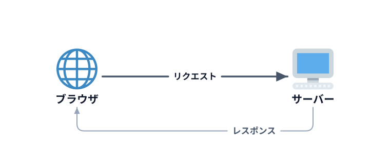

# genfig

自然文の説明を **イメージスキーマ**（Johnson『The Body in the Mind』, Lakoff & Johnson
『Metaphors We Live By』『Philosophy in the Flesh』に由来する、身体経験から繰り返し立ち
あらわれる空間構造）に写像し、その構造を **twemoji を登場物にした FigJam 風の SVG 図**
として描く [Claude Code / Agent Skill](https://docs.claude.com/en/docs/claude-code/skills) です。

例:「ブラウザがサーバーにリクエストしたらレスポンスが返ってくる」
→ SOURCE-PATH-GOAL（起点→経路→着点）+ CYCLE（往復）→ 左右 2 ノード＋往復 2 矢印の図。



## 特徴

- **SVG 単体・自己完結**。twemoji（カラー絵文字）も Lucide（ラインアイコン）も外部
  `href` ではなく **インライン**する（`genfig.py` が CDN から取得・キャッシュ・インライン化）。
  GitHub / Markdown / Astro どこでも描画される。
- **FigJam 風のデザイントークン**。カラー（8 色相 × 2 段階＋無彩色 4 段階）、
  4 フォントファミリー、段階的フォントスケール、16 種のシェイプ、コネクタを
  UI に 1:1 対応させた API で扱う。
- **日本語ラベル前提**。日本語フォントを優先指定する。
- 依存は Python 標準ライブラリのみ（`urllib` でアイコンを取得）。追加の pip パッケージ不要。

## インストール（Claude Code のスキルとして）

`~/.claude/skills/genfig`（ユーザー全体）または各リポジトリの `.claude/skills/genfig`
（プロジェクト単位）に配置する。

```sh
git clone https://github.com/seekseep/genfig-skill.git ~/.claude/skills/genfig
```

`~/.claude/skills/genfig/SKILL.md` が置かれれば Claude Code がスキルとして認識する。
「〜の図を作って」「この説明に図を入れて」のような依頼で発火する。

## 単体で使う

スキルとしてではなく、Python から直接使うこともできる。

```python
import sys
sys.path.insert(0, "path/to/genfig-skill")
from genfig import Canvas

c = Canvas(760, 300)
c.emoji("1f310", 80, 110, 80)                                       # 🌐 ブラウザ
c.text(120, 215, "ブラウザ", scale="heading")
c.emoji("1f5a5", 600, 110, 80)                                      # 🖥️ サーバー
c.text(640, 215, "サーバー", scale="heading")
c.connector(190, 120, 565, 120, label="リクエスト", primary=True)   # 往路（濃い）
c.connector(570, 180, 195, 180, label="レスポンス", primary=False)  # 復路（薄い）
c.save("out.svg")
```

```sh
python3 examples/request-response.py    # examples/request-response.svg を生成
rsvg-convert out.svg -o out.png         # 目視確認用に PNG 化（任意 / SVG レンダラは何でも可）
```

初回実行時に twemoji / Lucide のアイコンを `jsdelivr` の CDN から取得し、
`.twemoji-cache/` `.lucide-cache/` にキャッシュする（このリポジトリでは `.gitignore` 対象）。

## 構成

| パス | 内容 |
|---|---|
| `SKILL.md` | スキル本体。生成手順（7 ステップ）と API リファレンス。 |
| `genfig.py` | `Canvas` と描画プリミティブ。デザイントークンの定義。 |
| `examples/` | 実例（`request-response.py` とその出力 SVG）。 |
| `reference/schemas.md` | イメージスキーマの一覧・認識の手がかり・レイアウト指針。 |
| `reference/twemoji.md` | よく使う twemoji コードポイント早見表。 |

## ライセンス

MIT License. 詳細は [LICENSE](LICENSE) を参照。
